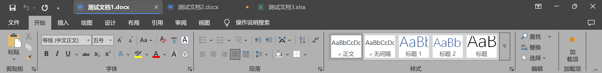
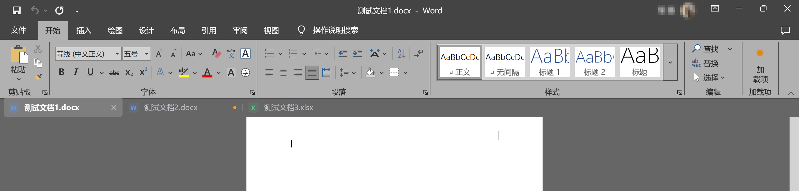

# DocTabs

轻量的 Office 文档标签栏：把 **Microsoft Word / Excel** 的多个窗口当作“一个窗口的多个标签”来切换，体验接近 WPS 的标签页。


[](LICENSE)
[](https://github.com/cmm101010/DocTabs/releases)

> 单个 exe，无需安装、无需 .NET SDK；同时注册为 Office COM 加载项，打开 Word / Excel 时自动启动，Office 全部关闭后自动退出。

当前版本：**1.5.7**（程序集版本 `1.5.7.0`）

## 目录

- [功能特性](#功能特性)
- [系统要求](#系统要求)
- [下载与安装](#下载与安装)
- [使用说明](#使用说明)
- [常见问题](#常见问题)
- [从源码构建](#从源码构建)
- [代码结构](#代码结构)
- [实现原理](#实现原理)
- [已知限制](#已知限制)
- [调试与日志](#调试与日志)
- [参与贡献](#参与贡献)
- [版本记录](#版本记录)
- [许可证与致谢](#许可证与致谢)

## 功能特性

- **标签切换**：所有打开的 Word / Excel 文档显示为标签，点击切换、拖动排序、鼠标滚轮依次切换。
- **最大化时**：标签栏固定在屏幕顶部，最大化的文档窗口整体下移让出位置；其他程序最大化不受影响。
- **小窗口时**：标签贴在窗口标题栏正上方随窗口移动；窗口太矮、上方放不下时自动隐藏，鼠标停在窗口上沿约 0.2 秒滑出。
- **整组联动**：一个文档最大化 / 还原 / 移动 / 缩放 / 最小化，同组其他文档同步为相同状态和位置。
- **拆分 / 合并**：把标签竖直拖出标签栏即拆成独立窗口（独立标签栏）；把窗口拖到另一个标签栏上松手即合并。右键标签也有“拆分为单独窗口”“合并所有窗口”。
- **拖标签栏移动窗口**：按住空白处（或单标签时按住标签）拖动窗口；松手时顶到屏幕上沿最大化，顶到左右边缘占半屏；双击空白处最大化 / 还原。
- **系统分屏**：窗口贴到屏幕上沿时自动下移让出标签栏，左右分屏各自显示标签。
- **随 Office 自动启动**：作为 COM 加载项随 Word / Excel 启动，Office 全部退出后自动退出，不常驻后台。
- **关闭行为**：
  - 标签上的 × 或中键：只关闭该文档
  - 窗口右上角 × 或 Alt+F4：整组依次关闭（未保存的逐个提示，点“取消”即停止）
  - 右键标签：关闭 / 关闭其他 / 关闭全部
- **未保存提示**：改过但未保存的文档，标签上显示琥珀色圆点。
- **全屏让位**：幻灯片放映、视频全屏等全屏程序在前台时自动隐藏。
- **托盘菜单**：开机自启动、退出。

只识别 Office 本体（`WINWORD.EXE` / `EXCEL.EXE`），不会收纳 WPS 的窗口。

## 系统要求

- Windows 10 / 11
- .NET Framework 4.7.2 及以上（Windows 10 1803 起系统自带）
- Microsoft Office 2013 及以上（每个文档单独一个窗口的版本）

## 下载与安装

1. 在 [Releases](https://github.com/cmm101010/DocTabs/releases) 下载 `DocTabs.exe`，放到任意固定文件夹。
2. 双击运行一次。打开 Word 或 Excel 后，标签栏会自动出现。
3. 首次运行会自动登记为 Office 插件（只写当前用户注册表，不需要管理员权限），以后打开 Office 就会自动带起 DocTabs。可在托盘菜单取消“打开 Word / Excel 时自动启动”。
4. 也可以改用开机自启动：右键托盘图标 → 勾选“开机自启动”。
5. 退出：右键托盘图标 → 退出（会把调整过的窗口恢复原状）。

**移动或删除程序**

- 移动 `DocTabs.exe` 后运行一次即可，插件登记会自动更新路径。
- 删除前先在托盘菜单取消“打开 Word / Excel 时自动启动”。
- 插件也会出现在 Office 的“文件 → 选项 → 加载项 → COM 加载项”里，名称是“DocTabs 文档标签栏”。

## 使用说明

### 标签栏模式

右键托盘图标 → “标签栏内嵌标题栏”可切换三种布局：

| 模式 | 效果 |
| --- | --- |
| 顶部跟随（默认） | 最大化时固定在屏幕顶部，小窗口时贴在标题栏上方 |
| 功能区下方 | 悬挂在 Word / Excel 功能区底边，不移动文档窗口 |
| 标题栏内嵌 | 标签直接画进 Office 标题栏，左侧避开快速访问工具栏，右侧避开窗口按钮 |

### 效果预览

**标题栏内嵌**



未保存的“测试文档2.docx”右侧显示琥珀色圆点。

**功能区下方**



标签栏停在功能区底边，Word 和 Excel 标签可以合并在同一栏。

### 拖拽操作

- 水平拖动标签：调整顺序。
- 竖直把标签拖出：拆成独立窗口。
- 把窗口拖到另一个标签栏：合并。
- 拖动标签栏空白处：移动整个窗口；顶到屏幕边缘触发最大化 / 半屏。

### 数据与隐私

- 不联网、不上传任何内容。
- 只读取窗口标题用于显示标签，读取文档“是否已保存”用于琥珀点。
- 设置保存在 `HKCU\Software\DocTabs`，日志在 `%LOCALAPPDATA%\DocTabs\DocTabs.log`。

## 常见问题

**Q：首次运行提示“未知发布者”？**
程序未做数字签名，Windows SmartScreen 会拦截。点“更多信息 → 仍要运行”。也可以按下面的方法自行编译。

**Q：打开 Word / Excel 没有出现标签栏？**
1. 托盘菜单确认“打开 Word / Excel 时自动启动”已勾选。
2. 删除 `HKCU\Software\DocTabs` 下的 `UserExited` 值后重试。
3. 查看 `%LOCALAPPDATA%\DocTabs\DocTabs.log`，里面记录了插件加载与退出原因。
4. 联想电脑管家、火绒等安全软件可能限制由 Office 启动的程序，把 `DocTabs.exe` 加入信任区。

**Q：为什么只支持 Word / Excel，不支持 WPS？**
程序按 Office 的窗口类（`OpusApp` / `XLMAIN`）和进程名识别文档窗口，WPS 的窗口结构不同，需要单独适配。

**Q：多个显示器、缩放不同会有问题吗？**
程序是 Per-Monitor V2 DPI 感知，标签栏会跟随文档所在显示器的缩放。

**Q：会不会影响文档内容？**
不会。程序只操作窗口位置与关闭消息（`WM_SYSCOMMAND / SC_CLOSE`），不读写文档内容。

## 从源码构建

不需要 Visual Studio 或 .NET SDK，使用 Windows 自带的 .NET Framework 编译器：

```bat
build.bat
```

产物为 `stage\DocTabs.exe`。编译前请先在托盘退出正在运行的 DocTabs；Word / Excel 开着时 exe 会被 Office 插件占用。

> 输出文件名必须保持 `DocTabs.exe`：程序集名要与注册表里 Office 插件的 `Assembly` 值一致，否则 Word 会静默跳过插件。

### 部署到本机安装目录

```powershell
.\deploy.ps1 -InstallDir "C:\Tools\DocTabs"
```

脚本会先备份旧版本，再覆盖 `DocTabs.exe`。目标目录由参数传入，仓库里不写死任何本机路径。

## 代码结构

源码只有一个文件 [`DocTabs.cs`](DocTabs.cs)，C# 5 / WinForms，无第三方依赖。按职责分为几块：

| 类型 | 位置（约） | 职责 |
| --- | --- | --- |
| `Program` | 35–85 | 入口、单实例互斥量、托盘图标与菜单 |
| `IDTExtensibility2` / `Connect` | 86–105 | Office COM 加载项入口，Office 加载时拉起主程序 |
| `OfficeAddin` | 106–497 | 插件注册 / 注销、自动启动、未保存状态上报 |
| `Log` | 498–515 | 本地日志，超过 64 KB 自动清空 |
| `DocKind` / `BarMode` | 516–519 | 文档类型与标签栏布局模式枚举 |
| `DocTab` | 520–532 | 单个标签的数据（窗口句柄、标题、进程等） |
| `Manager` | 533–1700 | 枚举文档窗口、分组、状态同步、关闭、事件分发 |
| `TabBar` | 1701–3428 | 标签栏窗口：绘制、命中测试、拖动、右键菜单、取色 |
| `DirtyWatcher` | 3429–3831 | 读取文档“是否已保存”，驱动琥珀点 |
| `Native` | 3832–3966 | Win32 P/Invoke 声明与结构体 |

### 目录结构

```text
DocTabs/
├─ DocTabs.cs                 主源码（单文件）
├─ build.bat                  编译脚本（系统自带 csc）
├─ deploy.ps1                 部署到指定安装目录
├─ CHANGELOG.md               版本修改记录
├─ CONTRIBUTING.md            贡献指南
├─ LICENSE                    MIT
├─ README.md
└─ .github/
   └─ workflows/
      └─ build.yml            GitHub Actions：每次提交自动编译
```

## 实现原理

- 用 `SetWinEventHook` 监听前台切换、窗口创建 / 销毁、位置变化、最小化、拖动开始 / 结束等事件；`EnumWindows` 按窗口类（`OpusApp` / `XLMAIN`）和进程名识别文档窗口。
- 最大化不使用 AppBar（不改变系统工作区），而是把最大化窗口整体下移，并盖住 Office 顶部多留的空白。
- 标签栏是 `WS_EX_NOACTIVATE` 的工具窗口，点击不抢焦点；文档在前台时置顶，切到其他程序时只紧贴文档窗口上一层。
- 浮动模式下标签以外区域用 `TransparencyKey` 透明，可以点穿。
- 整组关闭通过低级鼠标 / 键盘钩子只识别“在当前文档关闭按钮上松开左键”和 `Alt+F4`，不记录其他输入。
- Office 插件：exe 内实现 `IDTExtensibility2` 的 COM 类，登记在 `HKCU\Software\Classes\CLSID` 和 `HKCU\Software\Microsoft\Office\{Word,Excel}\Addins`；Office 加载时若 DocTabs 未运行则以 `/office` 参数启动，之后每 3 秒检查一次互斥量。
- 逐显示器 DPI 感知（Per-Monitor V2），标签栏高度与字体随文档所在屏幕缩放变化。
- 从标签栏拖动窗口时不走系统拖动流程，而是由标签栏捕获鼠标、异步挪动窗口；同组其他文档在拖动期间挪到当前显示器上方的屏幕外，避免 Excel 隐藏 / 显示窗口的几百毫秒开销。
- 关闭文档统一发送 `WM_SYSCOMMAND / SC_CLOSE`（与点标题栏 × 相同）；`WM_CLOSE` 会让 Excel 退出整个程序。
- 未保存状态由 Office 插件在 Word / Excel 自己的进程内轮询 `Document.Saved` / 工作簿 `Saved`，写入 `HKCU\Software\DocTabs\Dirty`，主程序读取并核对 PID。
- 插件登记时加入 Office 的“始终启用”列表（`Resiliency\DoNotDisableAddinList`），避免启动较慢时被自动停用。

## 已知限制

- 从标签栏拖动时的贴边只有最大化和左右半屏，没有系统的分屏布局提示；需要时拖 Office 自己的标题栏。
- 整组关闭依据鼠标是否点在 Office 标题栏右上角关闭按钮区域判断，界面布局特殊时可能识别不到（此时只关闭当前文档）。
- 多显示器时标签栏显示在当前文档所在显示器上。
- 只支持 Word / Excel，不支持 WPS。

## 调试与日志

- 日志：`%LOCALAPPDATA%\DocTabs\DocTabs.log`，超过 64 KB 自动清空。
- 常用排查点：
  - `插件已加载` / `插件未加载`：Office 是否成功拉起 DocTabs。
  - `未保存[Word/Excel]`：插件上报的保存状态。
  - `未保存标记`：主程序采纳的状态。
- 单实例互斥量 `DocTabs.SingleInstance.8F2C41` 按会话生效；不要在另一个桌面 / 沙箱里再启动一个实例，否则会把真实会话里的实例顶掉。

## 参与贡献

欢迎提交 Issue 和 Pull Request。请先阅读 [CONTRIBUTING.md](CONTRIBUTING.md)。

## 版本记录

见 [CHANGELOG.md](CHANGELOG.md)。当前版本 1.5.7 主要修复功能区下方模式的 Excel 定位、布局开关互斥和未保存圆点。

## 许可证与致谢

[MIT License](LICENSE)。

本项目基于 [stevensijd-qgg/DocTabs](https://github.com/stevensijd-qgg/DocTabs)（MIT）修改，
原版权归其作者所有；修改部分版权归 cmm101010 所有。
